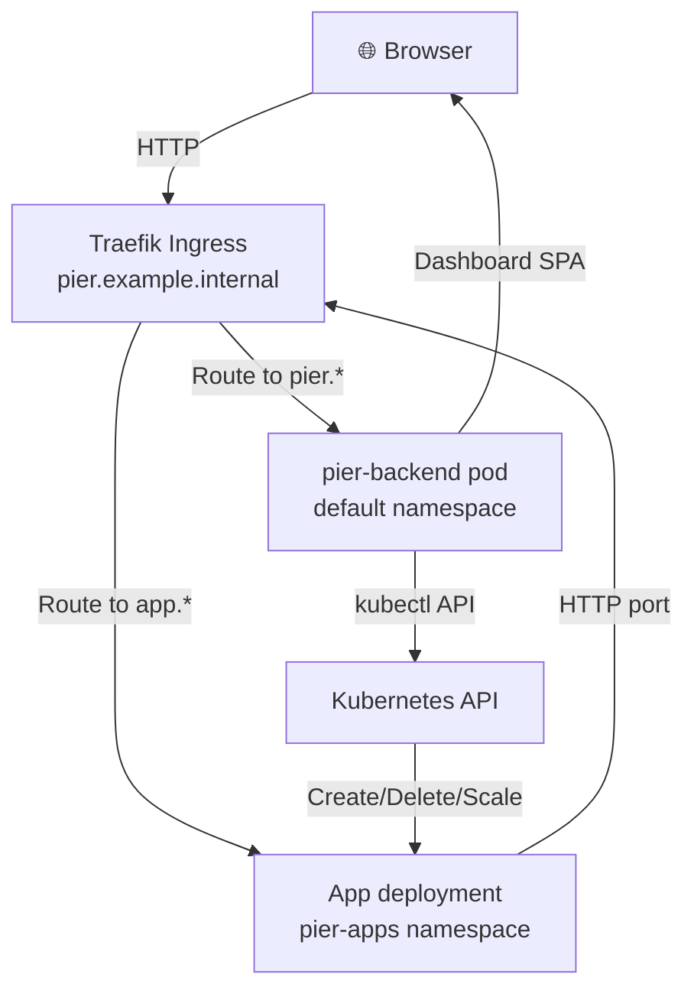

<p align="center">
  
</p>

<p align="center">
  <strong>Apps dock here.</strong>
</p>

<p align="center">
  <a href="https://k3s.io"></a>
  <a href="https://kubernetes.io"></a>
  <a href="https://www.proxmox.com"></a>
  <a href="https://ubuntu.com/server"></a>
</p>

<p align="center">
  <a href="https://www.typescriptlang.org"></a>
  <a href="https://nodejs.org"></a>
  <a href="https://fastify.dev"></a>
  <a href="https://github.com/kubernetes-client/javascript"></a>
  <a href="https://react.dev"></a>
  <a href="https://vite.dev"></a>
  <a href="https://tailwindcss.com"></a>
</p>

Pier is a lightweight control plane for k3s: a self-hosted dashboard for deploying, monitoring, and managing containerised apps on your own Kubernetes cluster.

## Why I built it

I wanted to actually learn Kubernetes, clusters, and how cloud platforms work under the hood, not just read about them. My home lab runs on Proxmox, and every time I wanted to test or deploy something I'd spin up yet another LXC container by hand. A cluster gives you all of that in one place (scheduling, restarts, networking, routing, scaling), so Pier is my way of building the "push an app, get a URL" experience on hardware I own.

## What it does

- **Deploy apps:** Push a Docker image, get a URL instantly via ingress (optional HTTPS through cert-manager)
- **Persistent volumes:** Attach retained local-path storage to apps; volume apps use one replica and Recreate updates.
- **Logs & monitoring:** Stream live logs, check pod status, see resource usage
- **Scaling:** Scale replicas up/down, pause with zero replicas
- **App settings:** Change image, port, env and CPU/RAM on a running app (with a quota pre-check)
- **Restart:** Trigger pod rollouts for live reload or recovery
- **Pod actions:** Restart one pod, inspect previous container logs, and read recent app events
- **Networking:** Apps reach public internet; isolated from each other and from the host LAN by default (configurable)
- **Cluster health:** Check API server status and node readiness
- **Activity log:** Every deploy, change, scale, restart, delete and sign-in is recorded (without secrets) in a small SQLite database and shown on the Activity page

## Architecture



**Backend:** Single Fastify pod in `default` namespace with ServiceAccount granting cluster-wide health read and namespace-scoped app management in `pier-apps`.

**Apps:** Run in isolated `pier-apps` namespace with:
- **Pod Security:** enforced `baseline`, warned `restricted`
- **NetworkPolicies:** default-deny ingress/egress, allows Traefik ingress and DNS; optional rules for private networks
- **ResourceQuota:** 2 CPU / 4Gi memory request/limit per namespace
- **Service type policy:** ClusterIP only (no NodePort/LoadBalancer)

## Prerequisites

Before you start, ensure your k3s node has:

- **k3s** ≥ v1.36 with **Traefik** ingress controller (default in k3s)
- **kubectl** pointed at the cluster (via `KUBECONFIG`)
- **Docker** on your local machine (to build and push images to the cluster)
- **SSH key access** to the k3s node with passwordless `sudo k3s ctr` (for image import)
- **Node.js** ≥ 22.13 (the backend uses the built-in `node:sqlite`), **pnpm** ≥ 9 (for local development)
- **Wildcard DNS** (e.g. `*.192.0.2.10.nip.io` or your own resolver; apps use `<name>.<domain>`)

## Setup from a blank k3s node

1. **Copy the kubeconfig** from the node to your local machine:
   ```bash
   scp your-ssh-user@192.0.2.10:/etc/rancher/k3s/k3s.yaml ~/.kube/config
   kubectl config set clusters.k3s.server https://192.0.2.10:6443
   # Edit ~/.kube/config and replace 127.0.0.1 with the node IP
   kubectl get nodes  # verify connection
   ```

2. **Clone pier and set env vars:**
   ```bash
   git clone <pier-repo>
   cd pier/backend
   cp .env.example .env
   ```
   Edit `backend/.env`:
   ```bash
   PIER_API_TOKEN=$(openssl rand -hex 32)
   K3S_HOST=192.0.2.10
   K3S_SSH_USER=your-ssh-user
   PIER_INGRESS_DOMAIN=192.0.2.10.nip.io
   PIER_DASHBOARD_HOST=pier.192.0.2.10.nip.io  # optional; derived if omitted
   ```

3. **Add SSH key to agent and deploy:**
   ```bash
   ssh-add ~/.ssh/id_ed25519  # or your key
   ./scripts/deploy-local.sh
   ```
   Wait for the rollout (up to 2 min).

4. **Open the dashboard:**
   ```
   http://pier.192.0.2.10.nip.io
   ```
   Log in with the token from `backend/.env`.

5. **Deploy your first app:**
   - Create a new app: name=`myapp`, image=`nginx:alpine`, port=`80`
   - Set host: `myapp.192.0.2.10.nip.io`
   - Open `http://myapp.192.0.2.10.nip.io` — Nginx is running

6. **Optional: turn on HTTPS.** Run `./scripts/install-cert-manager.sh`, add `PIER_TLS_ISSUER=pier-ca` to `backend/.env`, redeploy, and trust Pier's root CA on your machines. New apps then get `https://` URLs and HTTP redirects to HTTPS. Full steps are in [backend/k8s/README.md#tls](backend/k8s/README.md#tls).

## Upgrading

```bash
git pull origin main
./backend/scripts/deploy-local.sh
```

The script rebuilds the image, imports it, and rolls out the updated pod.

## Troubleshooting

- **Dashboard shows login screen (401):** bearer token is missing or wrong, or session expired. Log in again with the token from `PIER_API_TOKEN`.
- **Dashboard returns 404 via Traefik:** check that `PIER_INGRESS_DOMAIN` is set and the Ingress was created:
  ```bash
  kubectl get ingress -n default
  kubectl describe ingress pier-backend -n default
  ```
- **App stuck in "building" / ImagePullBackOff:** Pod wasn't created due to Pod Security or quota rejection. Debug with:
  ```bash
  kubectl get events -n pier-apps --sort-by=.lastTimestamp
  kubectl describe pod -n pier-apps
  ```
- **App can't reach your LAN (times out):** NetworkPolicy blocks private ranges. See [backend/k8s/README.md](backend/k8s/README.md#network-isolation-pier-apps) for custom rules.

For more details, see:
- [backend/README.md](backend/README.md#deploy-to-k3s) — Deploy script, token rotation, debugging
- [backend/k8s/README.md](backend/k8s/README.md) — Manifests, RBAC, Pod Security, quotas, network policies

## Development

[](https://github.com/Flapjacck/pier/actions/workflows/ci.yml)

This repo uses [pnpm](https://pnpm.io) (not npm). Backend and frontend are separate pnpm packages:

```bash
pnpm --dir backend install    # installs backend dependencies
pnpm --dir frontend install   # installs frontend dependencies
pnpm --dir backend dev        # http://127.0.0.1:3000
pnpm --dir frontend dev       # http://127.0.0.1:5173
```

### Local checks

Before pushing, run the linter, type-checker, and tests:

```bash
pnpm --dir backend lint      # ESLint
pnpm --dir backend typecheck # tsc --noEmit
pnpm --dir backend test      # node:test
pnpm --dir backend build     # tsup

pnpm --dir frontend lint     # ESLint
pnpm --dir frontend typecheck # tsc -b
pnpm --dir frontend test     # Vitest
pnpm --dir frontend build    # Vite

docker build -f backend/Dockerfile -t pier-backend:ci .  # the image deploy-local.sh ships
```

See [backend/README.md](./backend/README.md) for API/kubeconfig setup and [frontend/README.md](./frontend/README.md) for the dashboard stack, tokens, and assets.

**Design context:** [PRODUCT.md](./PRODUCT.md) and [DESIGN.md](./DESIGN.md) at the repo root are the durable product and design references for frontend work (including `impeccable` and issues #43–#47). Read them before changing UI.

### Contributing

See [CONTRIBUTING.md](./CONTRIBUTING.md) for:
- Commit conventions (conventional commits)
- Feature branch naming and workflow
- Code style and local checks
- Branch protection rules
