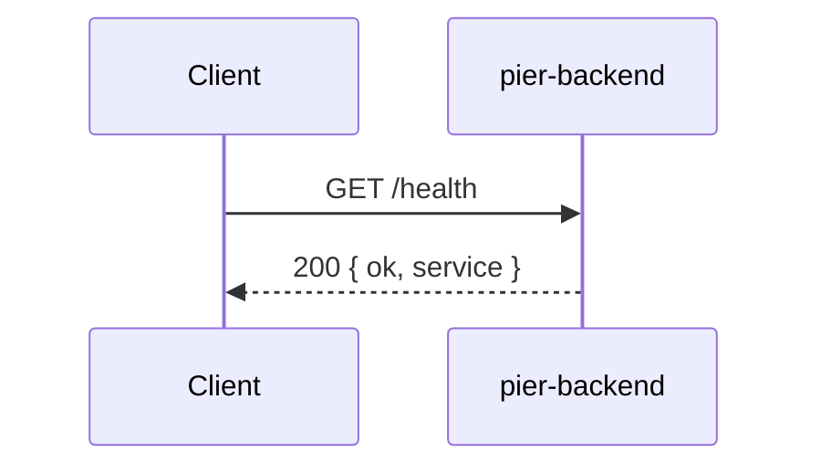
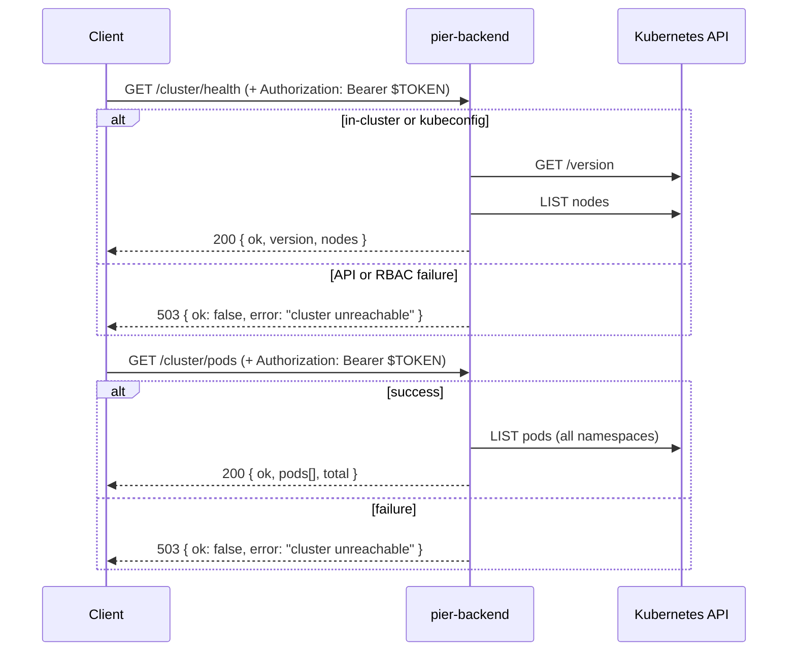

# HTTP routes

Pier backend exposes a small read-only API over Fastify. Handlers live in this folder; Kubernetes calls sit in `src/k8s/`.

## Routes (plain English)

| Method | Path | Auth | What it does |
|--------|------|------|----------------|
| GET | `/health` | None | Answers "is the Node process up?" No cluster call — safe for k8s liveness probes. |
| GET | `/cluster/health` | Bearer token | Answers "can this app talk to k3s?" Fetches API version and counts nodes that are Ready. |
| GET | `/cluster/pods` | Bearer token | Answers "what is running?" Lists every pod in every namespace with name, phase, node, and ready count. |
| GET | `/apps` | Bearer token | Lists Pier-managed apps (Deployments in `PIER_NAMESPACE` with label `pier.app`). Uses the namespaced Role in `k8s/rbac-apps.yaml`, not the cluster health ClusterRole. |

**Success:** JSON with `ok: true` and useful fields.  
**Auth failure:** HTTP **401** with `ok: false` and `error: "unauthorized"`.  
**Cluster errors** (bad creds, RBAC, API down): HTTP **503** with `ok: false` and a generic `error: "cluster unreachable"` message. Full error details are logged server-side.

**API credentials:** Bearer token set via `PIER_API_TOKEN` env var (see main `README.md`).  
**Kubernetes credentials:** In a pod, the ServiceAccount token is used. Locally, set `KUBECONFIG` (same as `kubectl`).

---

## `/health`



---

## `/cluster/health` and `/cluster/pods`



**RBAC (in-cluster):** ServiceAccount needs `list` on **nodes** and **pods** — see `k8s/rbac.yaml`.

---

## Files

| File | Routes |
|------|--------|
| `health.ts` | `/health` |
| `cluster.ts` | `/cluster/health`, `/cluster/pods` |
| `apps.ts` | `/apps` |

Registered from `src/app.ts`.

---

## `/apps` Deployment troubleshooting

When a Deployment is rejected by **Pod Security** standards or the **ResourceQuota**, the pods never become ready, and the app status shows as `building` (rollout in progress) or `failed` (deadline exceeded).

**To debug:**

```bash
# Check Deployment events and conditions (most recent first)
kubectl get events -n pier-apps --sort-by=.lastTimestamp

# Examine ReplicaSet status (usually the issue is in the pod template)
kubectl describe rs -n pier-apps

# Read the last pod's logs and events
kubectl describe pod -n pier-apps | tail -50
```

**Common rejections:**

| Error | Cause | Solution |
|-------|-------|----------|
| `violates PodSecurity "baseline:latest": privileged` | Container has `securityContext.privileged: true` | Remove `privileged: true` or use `allowPrivilegeEscalation: false` |
| `violates PodSecurity "baseline:latest": hostPath volumes` | Pod mounts `hostPath` | Use emptyDir, local, or named volumes instead |
| `violates PodSecurity "baseline:latest": hostNetwork` | Pod has `hostNetwork: true` | Remove `hostNetwork: true` |
| `failed to create Service: Services must be type ClusterIP` | Service type is NodePort, LoadBalancer, or ExternalName | Ensure `type: ClusterIP` in the Service spec |
| `exceeded quota: requests.cpu, requests.memory` | Pod has no CPU/memory requests and LimitRange defaults weren't applied | Check LimitRange; container must exist for defaults to apply |
