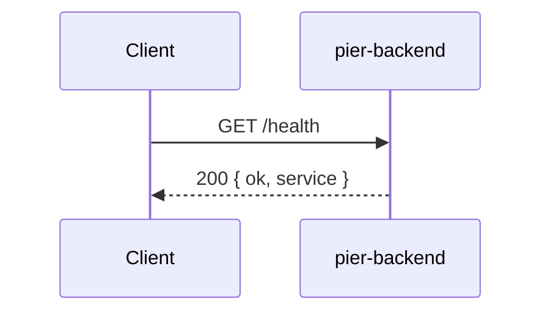
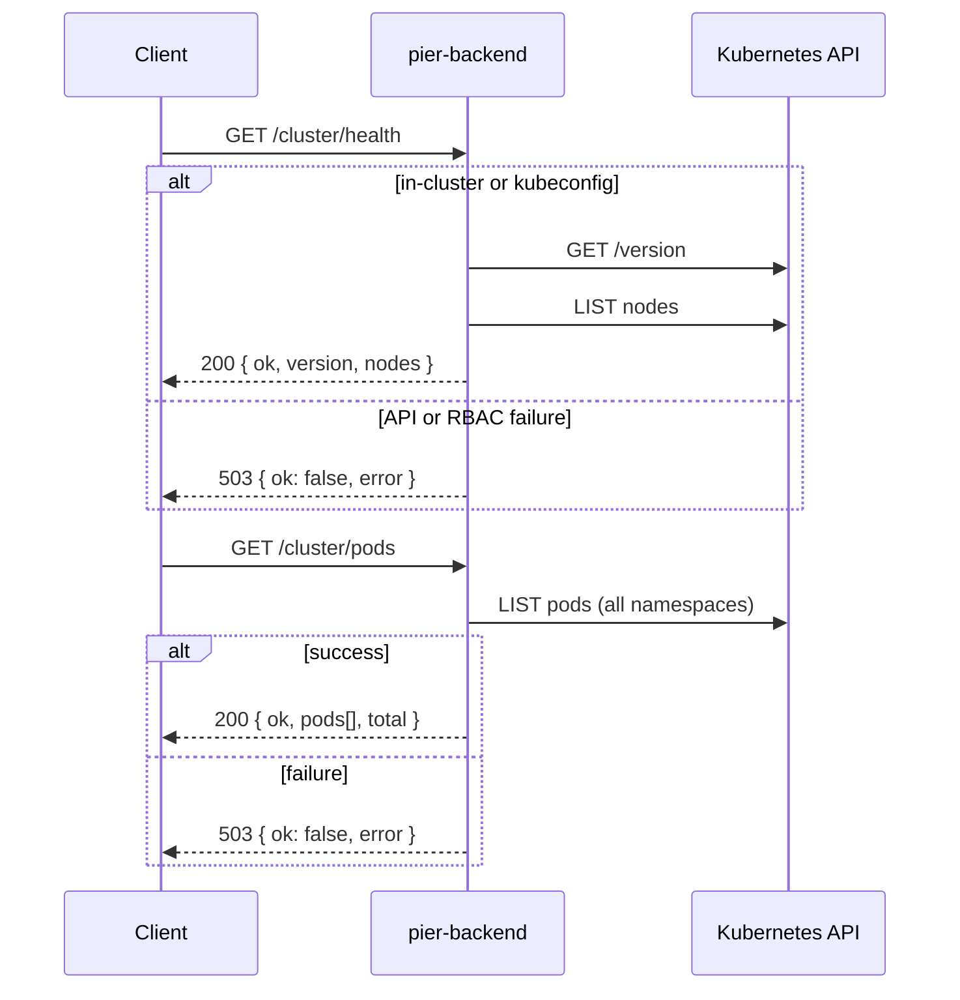

# HTTP routes

Pier backend exposes a small read-only API over Fastify. Handlers live in this folder; Kubernetes calls sit in `src/k8s/`.

## Routes (plain English)

| Method | Path | What it does |
|--------|------|----------------|
| GET | `/health` | Answers “is the Node process up?” No cluster call — safe for k8s liveness probes. |
| GET | `/cluster/health` | Answers “can this app talk to k3s?” Fetches API version and counts nodes that are Ready. |
| GET | `/cluster/pods` | Answers “what is running?” Lists every pod in every namespace with name, phase, node, and ready count. |

**Success:** JSON with `ok: true` and useful fields.  
**Cluster errors** (bad creds, RBAC, API down): HTTP **503** with `ok: false` and an `error` message.

**Credentials:** In a pod, the ServiceAccount token is used. Locally, set `KUBECONFIG` (same as `kubectl`).

---

## `/health`

---

## `/cluster/health` and `/cluster/pods`

**RBAC (in-cluster):** ServiceAccount needs `list` on **nodes** and **pods** — see `k8s/rbac.yaml`.

---

## Files

| File | Routes |
|------|--------|
| `health.ts` | `/health` |
| `cluster.ts` | `/cluster/health`, `/cluster/pods` |

Registered from `src/app.ts`.
