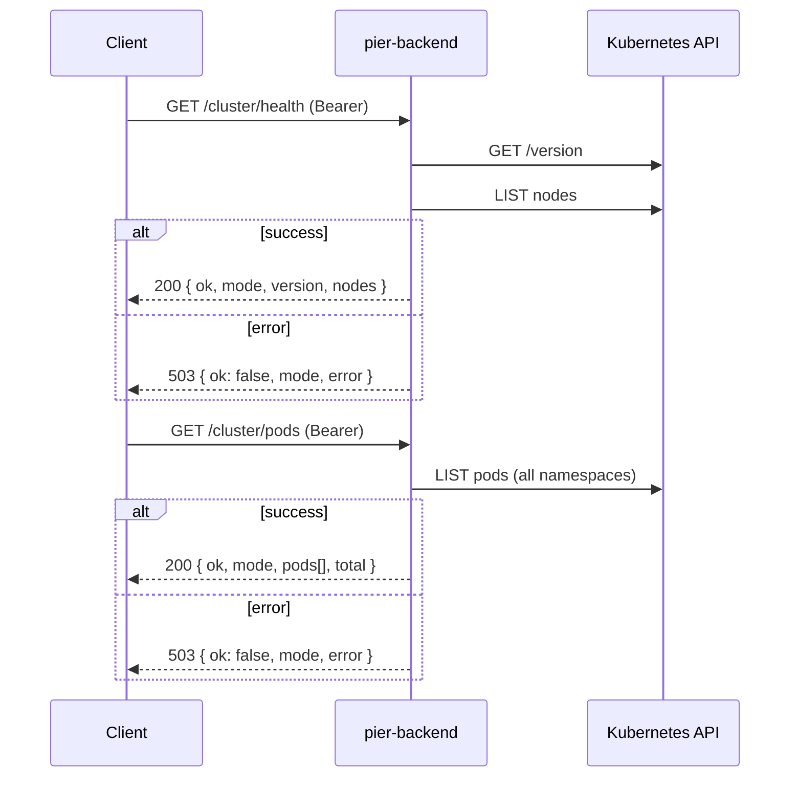

# HTTP routes

Fastify plugins registered from [`../app.ts`](../app.ts). Kubernetes calls live in [`../k8s/`](../k8s/README.md). `cluster.ts` and `apps.ts` export `*RoutesWithDeps()` factories so tests can inject fakes.

| File | Routes |
|------|--------|
| `health.ts` | `GET /health` |
| `cluster.ts` | `GET /cluster/health`, `GET /cluster/pods` |
| `apps.ts` | `GET /apps`, `POST /apps` |

## Common behaviour

- **Auth** (`../plugins/auth.ts`): every route except `/health` needs `Authorization: Bearer $PIER_API_TOKEN` when a token is configured. A wrong, missing or non-Bearer header returns `401 { "ok": false, "error": "unauthorized" }`. With no token, auth is skipped, which `config.ts` only allows on a loopback `HOST`.
- **Cluster clients**: `buildApp()` in `../app.ts` calls `createK8sClients()` once and passes the result to each route factory. If the kubeconfig failed to load, routes return `503 { "ok": false, "error": "cluster unreachable" }`. The same `503` is returned when a Kubernetes call fails. The full error goes to the server log only, never to the client.
- **Credentials**: `loadKubeConfig()` is called once at startup. Inside a pod it uses the ServiceAccount token (`in-cluster`); outside, `KUBECONFIG` (if set) or `~/.kube/config` (`kubeconfig`). Routes receive the mode from shared clients, so the response's `mode` field is always consistent for the lifetime of the app. A change to `KUBECONFIG` requires a restart.

## Adding a route

New cluster routes (#4 deploy, #5 pods and logs, #6 scale, restart and delete) should follow `apps.ts`:

1. Put the Kubernetes calls in a function in `../k8s/` that takes the API client it needs and throws on error.
2. Export a `*RoutesWithDeps(deps)` factory that takes `k8s: K8sClientsResult`, plus any config it needs, such as `namespace`.
3. Return `503` with the generic body when `deps.k8s.ok` is false or the call throws, and log the error with `req.log.error`.
4. Register it in `buildApp()` with the shared `k8sResult`. Don't call `loadKubeConfig()` or `createK8sClients()` in a route.
5. Test through `buildApp(testConfig(), { logger: false, k8s: createFakeClientsResult({ ... }) })` so auth and registration are covered too.

```ts
// restartApp would live in ../k8s/apps.ts
export function restartRoutesWithDeps(deps: { k8s: K8sClientsResult; namespace: string }): FastifyPluginAsync {
  return async (app) => {
    app.post<{ Params: { name: string } }>("/apps/:name/restart", async (req, reply) => {
      if (!deps.k8s.ok) {
        return reply.status(503).send({ ok: false, error: "cluster unreachable" });
      }
      try {
        return await restartApp(deps.k8s.clients.apps, deps.namespace, req.params.name);
      } catch (err) {
        req.log.error({ err }, "restart app failed");
        return reply.status(503).send({ ok: false, error: "cluster unreachable" });
      }
    });
  };
}
```

## `GET /health`

No auth, no cluster call. Used by the liveness and readiness probes.

```json
{ "ok": true, "service": "pier-backend" }
```

## `GET /cluster/health` and `GET /cluster/pods`



`/cluster/health` returns `200` whenever the API answers. `ok` is `false` if there are no nodes or any node isn't `Ready`.

```json
{ "ok": true, "mode": "in-cluster", "version": "v1.36.5+k3s1", "nodes": { "total": 1, "ready": 1 } }
```

Each entry in `/cluster/pods`'s `pods[]` looks like this (`nodeName` and `startedAt` are omitted when unset):

```json
{ "name": "coredns-7cfb7bc9c7-abcde", "namespace": "kube-system", "phase": "Running", "nodeName": "k3s-node", "ready": "1/1", "startedAt": "2026-10-29T15:00:00.000Z" }
```

RBAC: the ClusterRole `pier-backend-cluster-health` in [`../../k8s/rbac.yaml`](../../k8s/rbac.yaml).

## `GET /apps`

Lists Deployments in `PIER_NAMESPACE` (default `pier-apps`) that have the `pier.app` label. Unlabelled Deployments are skipped. The result is a bare JSON array sorted by name, and `[]` when there are none. Fastify validates it against the response schema in `apps.ts`.

```json
[
  { "name": "hello", "image": "nginx:1.27", "replicas": 2, "ready": 2, "status": "running", "createdAt": "2026-10-29T15:00:00.000Z" }
]
```

- `name` comes from the `pier.app` label value, falling back to `metadata.name`.
- `image` is the first container's image.
- `replicas` is `spec.replicas` (default 1), and `ready` is `status.readyReplicas` (default 0).

`status` (`deriveStatus` in `../k8s/apps.ts`) is decided by the first rule that matches, in this order:

| `status` | Rule |
|----------|------|
| `failed` | `Progressing` reason is `ProgressDeadlineExceeded`, or `Available=False` while `Progressing` isn't `True` |
| `stopped` | `replicas` is 0 |
| `running` | `readyReplicas` and `updatedReplicas` both equal `replicas`, and `observedGeneration` ≥ `generation` |
| `building` | anything else (rollout in progress, pods not ready) |

The 503 body is `{ "ok": false, "error": "cluster unreachable" }`, without `mode`.

RBAC: the Role `pier-app-manager` in [`../../k8s/rbac-apps.yaml`](../../k8s/rbac-apps.yaml), not the cluster ClusterRole.

If an app stays `building` or turns `failed` because Pod Security or the quota rejected its pods, see [Debugging rejected apps](../../k8s/README.md#debugging-rejected-apps).

## `POST /apps`

Create a Deployment, Service, and optionally an Ingress in `PIER_NAMESPACE`. Orchestrates creation in order, with pre-checks for conflicts and rollback on failure.

### Request

```json
{
  "name": "hello",
  "image": "nginx:1.27",
  "port": 80,
  "replicas": 2,
  "host": "hello.example.com",
  "env": { "DEBUG": "1", "LOG_LEVEL": "info" }
}
```

- `name` **(required)**: DNS-1035 name (DNS name with leading letter). Pattern: `^[a-z]([-a-z0-9]{0,61}[a-z0-9])?$` (1–63 chars).
- `image` **(required)**: Container image (1–255 chars, no whitespace). Example: `nginx:1.27`, `gcr.io/my-project/app:v1.0.0`.
- `port` **(required)**: Container port (integer 1–65535).
- `replicas`: Desired replicas (integer 0–10, default 1). Scale to 0 to pause an app.
- `host`: Ingress hostname for the app (must end with `.` + `PIER_INGRESS_DOMAIN`, e.g. `hello.10.0.0.87.nip.io`). Only created if provided. Requires `PIER_INGRESS_DOMAIN` to be configured.
- `env`: Environment variables as key-value pairs (up to 50 keys). Keys must match `^[A-Za-z_][A-Za-z0-9_]*$`; values are strings ≤4096 chars. Variables are sorted by key in the Pod spec.

### Response

**201 (success)**: the created App (same shape as `GET /apps`):
```json
{ "name": "hello", "image": "nginx:1.27", "replicas": 2, "ready": 0, "status": "building", "createdAt": "2026-10-31T16:00:00.000Z" }
```

**400 (validation error)**:
```json
{ "ok": false, "error": "invalid request", "details": "name must start with a letter..." }
```
Reasons: malformed `name` (leading digit, uppercase, trailing hyphen), `port` out of range, `replicas` > 10, bad `env` key, missing required fields, extra properties, `host` mismatch with `PIER_INGRESS_DOMAIN`, or `host` set when `PIER_INGRESS_DOMAIN` is unconfigured.

**401 (unauthorized)**: (same as GET /apps)

**409 (conflict)**:
```json
{ "ok": false, "error": "app already exists" }
```
or
```json
{ "ok": false, "error": "host already in use" }
```
Reasons: Deployment with that name already exists in `PIER_NAMESPACE`; or Ingress host is already claimed by another app. Both are checked before creation begins.

**503 (cluster unreachable)**: (same as GET /apps) — full error logged server-side, never sent to client.

### Manifest builders and creation

The creation process is orchestrated by `src/k8s/create-app.ts`:

1. **Pre-checks** (fail fast, no partial state):
   - `readNamespacedDeployment` → if found, throw `AppExistsError` (404 is fine).
   - if `host` provided, `listNamespacedIngress` with `app.kubernetes.io/managed-by=pier` label; scan all rules for matching hosts → if found, throw `HostInUseError`.

2. **Creation in order** (atomic from the client's perspective; Kubernetes may still have transient errors):
   - `createNamespacedDeployment` with labels, security settings, resources (see [`src/k8s/manifests.ts`](../k8s/README.md)).
   - `createNamespacedService` (ClusterIP) with owner reference pointing to the Deployment.
   - `createNamespacedIngress` if host provided, with owner reference pointing to the Deployment.

3. **Rollback on any creation failure** (best effort, logged, doesn't mask original error):
   - If Service or Ingress fails, delete created resources in reverse order (Ingress → Service → Deployment).
   - Each delete attempt is logged if it fails; the original error is re-thrown.
   - A 409 from the API during create is wrapped in `AppExistsError` (race with another POST request).

### Pod Security and resources

Apps created by POST /apps run in `pier-apps` namespace, which enforces **Pod Security baseline** with **restricted** on warning. The Deployment spec includes:
- **Pod Security Context**: `seccompProfile.type: RuntimeDefault`, `automountServiceAccountToken: false`.
- **Container Security Context**: `allowPrivilegeEscalation: false`, `capabilities: drop: ["ALL"]`.
- **Resources**: requests `cpu: 50m, memory: 64Mi, ephemeral-storage: 64Mi`; limits `cpu: 500m, memory: 256Mi, ephemeral-storage: 1Gi`.
- **Readiness probe**: TCP socket on the container port, `initialDelaySeconds: 2, periodSeconds: 5` (waits 2s before first check; rechecks every 5s).
- **Labels**: `pier.app: <name>` (app identity), `app.kubernetes.io/managed-by: pier` (owner tracking for garbage collection).

RBAC: the Role `pier-app-manager` in [`../../k8s/rbac-apps.yaml`](../../k8s/rbac-apps.yaml) grants `create`, `get`, `list`, `delete` on `deployments`, `services`, and `ingresses` in `pier-apps`.

### Host rules

If `host` is provided:
- Must be lowercase, valid DNS name, ≤253 chars total.
- Must end with `.` + `PIER_INGRESS_DOMAIN` (e.g. if domain is `example.com`, host must be `hello.example.com`, not `helloexample.com` or `example.com`).
- Cannot equal `PIER_INGRESS_DOMAIN` itself.
- Ingress is created with `ingressClassName: traefik`, one rule `host: <host>` → path `/` (Prefix) → Service port 80.
- If `PIER_INGRESS_DOMAIN` is not configured (empty or unset), `host` is rejected with 400.

### Example flow

```bash
TOKEN=<token>
# Create an app without ingress (internal-only).
curl -X POST -H "Authorization: Bearer $TOKEN" -H "Content-Type: application/json" \
  -d '{"name":"api","image":"myimage:v1","port":8080,"replicas":2}' \
  http://pier-backend:3000/apps
# Response: 201 { name: "api", ..., status: "building" }

# Wait for it to stabilize.
sleep 5

# Create with ingress (publicly routable via Traefik).
curl -X POST -H "Authorization: Bearer $TOKEN" -H "Content-Type: application/json" \
  -d '{"name":"web","image":"nginx:latest","port":80,"host":"web.example.com","env":{"WORKER_PROCESSES":"2"}}' \
  http://pier-backend:3000/apps
# Response: 201 { name: "web", ..., status: "building" }

# List all apps.
curl -H "Authorization: Bearer $TOKEN" http://pier-backend:3000/apps
# Response: 200 [ { name: "api", ... }, { name: "web", ... } ]
```
