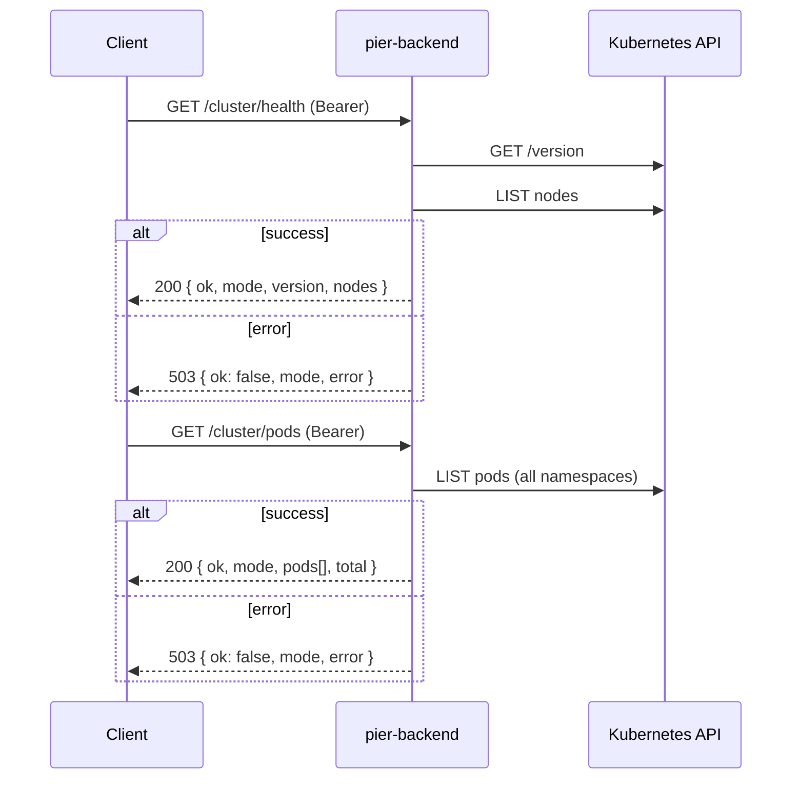

# HTTP routes

Fastify plugins registered from [`../app.ts`](../app.ts). Kubernetes calls live in [`../k8s/`](../k8s/README.md). `cluster.ts` and `apps.ts` export `*RoutesWithDeps()` factories so tests can inject fakes.

| File | Routes |
|------|--------|
| `health.ts` | `GET /health` |
| `cluster.ts` | `GET /cluster/health`, `GET /cluster/pods` |
| `apps.ts` | `GET /apps`, `POST /apps` |

## Common behaviour

- **Auth** (`../plugins/auth.ts`): every route except `/health` needs `Authorization: Bearer $PIER_API_TOKEN` when a token is configured. A wrong, missing or non-Bearer header returns `401 { "ok": false, "error": "unauthorized" }`. With no token, auth is skipped, which `config.ts` only allows on a loopback `HOST`.
- **Cluster clients**: `buildApp()` in `../app.ts` calls `createK8sClients()` once and passes the result to each route factory. If the kubeconfig failed to load, routes return `503 { "ok": false, "error": "cluster unreachable" }`. The same `503` is returned when a Kubernetes call fails. The full error goes to the server log only, never to the client.
- **Credentials**: `loadKubeConfig()` is called once at startup. Inside a pod it uses the ServiceAccount token (`in-cluster`); outside, `KUBECONFIG` (if set) or `~/.kube/config` (`kubeconfig`). Routes receive the mode from shared clients, so the response's `mode` field is always consistent for the lifetime of the app. A change to `KUBECONFIG` requires a restart.

## Adding a route

New cluster routes (#4 deploy, #5 pods and logs, #6 scale, restart and delete) should follow `apps.ts`:

1. Put the Kubernetes calls in a function in `../k8s/` that takes the API client it needs and throws on error.
2. Export a `*RoutesWithDeps(deps)` factory that takes `k8s: K8sClientsResult`, plus any config it needs, such as `namespace`.
3. Return `503` with the generic body when `deps.k8s.ok` is false or the call throws, and log the error with `req.log.error`.
4. Register it in `buildApp()` with the shared `k8sResult`. Don't call `loadKubeConfig()` or `createK8sClients()` in a route.
5. Test through `buildApp(testConfig(), { logger: false, k8s: createFakeClientsResult({ ... }) })` so auth and registration are covered too.

```ts
// restartApp would live in ../k8s/apps.ts
export function restartRoutesWithDeps(deps: { k8s: K8sClientsResult; namespace: string }): FastifyPluginAsync {
  return async (app) => {
    app.post<{ Params: { name: string } }>("/apps/:name/restart", async (req, reply) => {
      if (!deps.k8s.ok) {
        return reply.status(503).send({ ok: false, error: "cluster unreachable" });
      }
      try {
        return await restartApp(deps.k8s.clients.apps, deps.namespace, req.params.name);
      } catch (err) {
        req.log.error({ err }, "restart app failed");
        return reply.status(503).send({ ok: false, error: "cluster unreachable" });
      }
    });
  };
}
```

## `GET /health`

No auth, no cluster call. Used by the liveness and readiness probes.

```json
{ "ok": true, "service": "pier-backend" }
```

## `GET /cluster/health` and `GET /cluster/pods`



`/cluster/health` returns `200` whenever the API answers. `ok` is `false` if there are no nodes or any node isn't `Ready`.

```json
{ "ok": true, "mode": "in-cluster", "version": "v1.36.5+k3s1", "nodes": { "total": 1, "ready": 1 } }
```

Each entry in `/cluster/pods`'s `pods[]` looks like this (`nodeName` and `startedAt` are omitted when unset):

```json
{ "name": "coredns-7cfb7bc9c7-abcde", "namespace": "kube-system", "phase": "Running", "nodeName": "k3s-node", "ready": "1/1", "startedAt": "2026-10-29T15:00:00.000Z" }
```

RBAC: the ClusterRole `pier-backend-cluster-health` in [`../../k8s/rbac.yaml`](../../k8s/rbac.yaml).

## `GET /apps`

Lists Deployments in `PIER_NAMESPACE` (default `pier-apps`) that have the `pier.app` label. Unlabelled Deployments are skipped. The result is a bare JSON array sorted by name, and `[]` when there are none. Fastify validates it against the response schema in `apps.ts`.

```json
[
  { "name": "hello", "image": "nginx:1.27", "replicas": 2, "ready": 2, "status": "running", "createdAt": "2026-10-29T15:00:00.000Z" }
]
```

- `name` comes from the `pier.app` label value, falling back to `metadata.name`.
- `image` is the first container's image.
- `replicas` is `spec.replicas` (default 1), and `ready` is `status.readyReplicas` (default 0).

`status` (`deriveStatus` in `../k8s/apps.ts`) is decided by the first rule that matches, in this order:

| `status` | Rule |
|----------|------|
| `failed` | `Progressing` reason is `ProgressDeadlineExceeded`, or `Available=False` while `Progressing` isn't `True` |
| `stopped` | `replicas` is 0 |
| `running` | `readyReplicas` and `updatedReplicas` both equal `replicas`, and `observedGeneration` ≥ `generation` |
| `building` | anything else (rollout in progress, pods not ready) |

The 503 body is `{ "ok": false, "error": "cluster unreachable" }`, without `mode`.

RBAC: the Role `pier-app-manager` in [`../../k8s/rbac-apps.yaml`](../../k8s/rbac-apps.yaml), not the cluster ClusterRole.

If an app stays `building` or turns `failed` because Pod Security or the quota rejected its pods, see [Debugging rejected apps](../../k8s/README.md#debugging-rejected-apps).

## `POST /apps`

Create a Deployment, Service, and optionally an Ingress in `PIER_NAMESPACE`. Orchestrates creation in order, with pre-checks for conflicts and rollback on failure.

### Request

```json
{
  "name": "hello",
  "image": "nginx:1.27",
  "port": 80,
  "replicas": 2,
  "host": "hello.example.com",
  "env": { "DEBUG": "1", "LOG_LEVEL": "info" }
}
```

| Field | Type | Required | Constraints | Notes |
|-------|------|----------|-------------|-------|
| `name` | string | Yes | Pattern: `^[a-z]([-a-z0-9]{0,61}[a-z0-9])?$` (1–63 chars) | DNS-1035 name (leading letter, lowercase, hyphens OK). |
| `image` | string | Yes | 1–255 chars, no whitespace | Container image URL, e.g. `nginx:1.27`, `gcr.io/my-project/app:v1.0.0`. |
| `port` | integer | Yes | 1–65535 | Container port number. |
| `replicas` | integer | No | 0–10, default 1 | Desired replicas. Use 0 to pause an app. |
| `host` | string | No | 1–253 chars, DNS-1123 format, must end with `.PIER_INGRESS_DOMAIN` | Ingress hostname. Requires `PIER_INGRESS_DOMAIN` to be configured. Automatically lowercased. |
| `env` | object | No | ≤50 keys, key pattern `^[A-Za-z_][A-Za-z0-9_]*$`, values ≤4096 chars | Environment variables. |

**Unknown properties are rejected** — the request body schema uses `additionalProperties: false`, so any field not listed above returns 400.

### Response

**201 (success)**: the created App (same shape as `GET /apps`):
```json
{ "name": "hello", "image": "nginx:1.27", "replicas": 2, "ready": 0, "status": "building", "createdAt": "2026-10-31T16:00:00.000Z" }
```

| Status | Error | Details? | Reason |
|--------|-------|----------|--------|
| **400** | `invalid request` | Yes | Schema validation failed: malformed `name`, `port`/`replicas` out of range, bad `env` key, missing required fields, unknown property, `host` mismatch with `PIER_INGRESS_DOMAIN`, or `host` provided when `PIER_INGRESS_DOMAIN` unconfigured. |
| **401** | `unauthorized` | No | Missing or wrong Bearer token. |
| **403** | `quota exceeded` | Yes | Kubernetes API reported resource quota exceeded. Details include the quota message. |
| **403** | `forbidden by cluster` | Yes | Kubernetes API returned 403 for other reasons (RBAC, etc.). Details include the API message. |
| **409** | `app already exists` | No | Deployment with that name already exists in `PIER_NAMESPACE`. |
| **409** | `host already in use` | No | Ingress host is already claimed by another app (case-insensitive check). |
| **422** | `rejected by cluster` | Yes | Pod Security Policy or Validating Admission Policy rejected the pod. Details include the policy message. |
| **503** | `cluster unreachable` | No | Kubernetes API unreachable or other 5xx error. Full error logged server-side, never sent to client. |

**Global validation `details` field**: When the request body schema validation fails (status 400), the error handler extracts the first validation error from AJV and includes it in the `details` field for debugging (e.g., `"name must have required property"`). Routes whose response schema includes `details` will strip it if the route doesn't send it, so errors are safe.

### Manifest builders and creation

The creation process is orchestrated by `src/k8s/create-app.ts`:

1. **Pre-checks** (fail fast, no partial state):
   - `readNamespacedDeployment` → if found, throw `AppExistsError` (404 is fine).
   - if `host` provided, `listNamespacedIngress` with `app.kubernetes.io/managed-by=pier` label; scan all rules for matching hosts → if found, throw `HostInUseError`.

2. **Creation in order** (atomic from the client's perspective; Kubernetes may still have transient errors):
   - `createNamespacedDeployment` with labels, security settings, resources (see [`src/k8s/manifests.ts`](../k8s/README.md)).
   - `createNamespacedService` (ClusterIP) with owner reference pointing to the Deployment.
   - `createNamespacedIngress` if host provided, with owner reference pointing to the Deployment.

3. **Rollback on any creation failure** (best effort, logged, doesn't mask original error):
   - If Service or Ingress fails, delete created resources in reverse order (Ingress → Service → Deployment).
   - Each delete attempt is logged if it fails; the original error is re-thrown.
   - A 409 from the API during create is wrapped in `AppExistsError` (race with another POST request).

### Pod Security and resources

Apps created by POST /apps run in `pier-apps` namespace, which enforces **Pod Security baseline** with **restricted** on warning. The Deployment spec includes:
- **Pod Security Context**: `seccompProfile.type: RuntimeDefault`, `automountServiceAccountToken: false`.
- **Container Security Context**: `allowPrivilegeEscalation: false`, `capabilities: drop: ["ALL"]`.
- **Resources**: requests `cpu: 50m, memory: 64Mi, ephemeral-storage: 64Mi`; limits `cpu: 500m, memory: 256Mi, ephemeral-storage: 1Gi`.
- **Readiness probe**: TCP socket on the container port, `initialDelaySeconds: 2, periodSeconds: 5` (waits 2s before first check; rechecks every 5s).
- **Labels**: `pier.app: <name>` (app identity), `app.kubernetes.io/managed-by: pier` (owner tracking for garbage collection).

RBAC: the Role `pier-app-manager` in [`../../k8s/rbac-apps.yaml`](../../k8s/rbac-apps.yaml) grants `create`, `get`, `list`, `delete` on `deployments`, `services`, and `ingresses` in `pier-apps`.

### Host rules

If `host` is provided:
- **Automatically lowercased** to ensure case-insensitive matching in Ingress rules. Example: `Hello.192.0.2.10.nip.io` becomes `hello.192.0.2.10.nip.io`.
- Must be a valid **DNS-1123 hostname** (lowercase letters, digits, hyphens, no wildcards). Pattern: `[a-z0-9]([a-z0-9-]{0,61}[a-z0-9])?` per label. Rejected with 400 if invalid.
- Must NOT contain wildcards (`*`). Rejected with 400 if wildcard present (prevents overly-broad rules).
- Must end with `.` + `PIER_INGRESS_DOMAIN` (e.g. if domain is `192.0.2.10.nip.io`, host must be `hello.192.0.2.10.nip.io`, not `helloexample.com` or `192.0.2.10.nip.io` itself).
- Cannot equal `PIER_INGRESS_DOMAIN` itself. Rejected with 400.
- **Case-insensitive host conflict check**: The pre-creation host-in-use check compares hosts case-insensitively, so uppercase `HELLO.example.com` conflicts with existing lowercase `hello.example.com`.
- Ingress is created with `ingressClassName: traefik`, one rule `host: <host>` (lowercased) → path `/` (Prefix) → Service port 80.
- If `PIER_INGRESS_DOMAIN` is not configured (empty or unset), `host` is rejected with 400.
- **TLS:** Assumes Traefik is configured for TLS termination on ingress hosts. Traefik routes must have TLS enabled; HTTP-only will expose traffic in plaintext. See [#27](https://github.com/Flapjacck/pier/issues/27) for TLS enforcement.

### Network isolation

Apps deployed via POST /apps run in the `pier-apps` namespace, which is protected by **NetworkPolicies** that enforce network segmentation:

- **Incoming:** Apps can only receive traffic from Traefik (ingress controller in `kube-system`). Other apps cannot reach each other; internal communication requires going through Traefik (HTTP/HTTPS ingress).
- **Outgoing:** Apps can reach DNS for name resolution (kube-dns in `kube-system`) and public internet (`0.0.0.0/0`), but NOT private RFC1918 ranges (`10.0.0.0/8`, `172.16.0.0/12`, `192.168.0.0/16`), link-local (`169.254.0.0/16`), or shared address space (`100.64.0.0/10`). This blocks access to other apps, pier-backend, and the home LAN.

**Troubleshooting:** If an app attempts to reach a cluster service (e.g., pier-backend), another app, or a private LAN address and the connection times out, this is by design. Check the NetworkPolicy rules:

```bash
kubectl describe netpol -n pier-apps
```

To allow app-to-app communication on a private network, add an optional NetworkPolicy (see [`../../k8s/networkpolicies.yaml`](../../k8s/networkpolicies.yaml) for an example).

### Example flow

```bash
TOKEN=<token>
# Create an app without ingress (internal-only).
curl -X POST -H "Authorization: Bearer $TOKEN" -H "Content-Type: application/json" \
  -d '{"name":"api","image":"myimage:v1","port":8080,"replicas":2}' \
  http://pier-backend:3000/apps
# Response: 201 { name: "api", ..., status: "building" }

# Wait for it to stabilize.
sleep 5

# Create with ingress (publicly routable via Traefik).
curl -X POST -H "Authorization: Bearer $TOKEN" -H "Content-Type: application/json" \
  -d '{"name":"web","image":"nginx:latest","port":80,"host":"web.example.com","env":{"WORKER_PROCESSES":"2"}}' \
  http://pier-backend:3000/apps
# Response: 201 { name: "web", ..., status: "building" }

# List all apps.
curl -H "Authorization: Bearer $TOKEN" http://pier-backend:3000/apps
# Response: 200 [ { name: "api", ... }, { name: "web", ... } ]
```

## `GET /apps/:name/logs`

Stream logs from a running pod's container. Supports both plain-text (follow=false, default) and Server-Sent Events (SSE) streaming (follow=true).

### Query Parameters

| Parameter | Type | Default | Range/Format | Description |
|-----------|------|---------|--------------|-------------|
| `pod` | string | (first pod) | DNS-1123 subdomain, ≤253 chars | Pod name to stream from. If omitted, defaults to the first pod. |
| `tail` | integer | 200 | 1–5000 | Number of lines to stream from the end of the log. |
| `follow` | boolean | false | true/false | Stream new lines as they arrive (SSE) or just the historical tail (plain text). |

### Response

**200 (success) with follow=false**: Plain text (one line per log line). Content-Type: `text/plain; charset=utf-8`.

```
2026-10-31T15:00:00Z [INFO] App started
2026-10-31T15:00:01Z [INFO] Listening on port 8080
```

**200 (success) with follow=true**: Server-Sent Events stream. Content-Type: `text/event-stream; charset=utf-8`.

Headers also include:
- `cache-control: no-cache` (prevent caching)
- `connection: keep-alive` (keep socket open)
- `x-accel-buffering: no` (disable proxy buffering)

Frame format (one per event):

```
data: <log line>\n
\n
```

Special frames:

- **Ping**: `: ping\n\n` — sent every 15 seconds to keep the connection alive.
- **End**: `event: end\ndata: \n\n` — sent when upstream log stream ends normally (no more logs).
- **Error**: `event: error\ndata: upstream error\n\n` — sent if the Kubernetes log stream fails.

**400 (validation error)**: One of the query parameters failed validation.

```json
{ "ok": false, "error": "invalid request" }
```

Reasons: `tail` < 1 or > 5000, `tail` non-integer, `pod` has invalid DNS-1123 characters or > 253 chars, invalid app name.

**401 (unauthorized)**: missing or wrong bearer token.

**404 (not found)**:

```json
{ "ok": false, "error": "app not found" }
```

or

```json
{ "ok": false, "error": "no pods" }
```

or

```json
{ "ok": false, "error": "pod not found" }
```

**503 (cluster unreachable)**: Kubernetes API unreachable or request failed.

### SSE Client Behavior

Client should reconnect with exponential backoff if the connection closes. The `EventSource` API (browser) or a compatible library handles this automatically.

```javascript
const eventSource = new EventSource("/apps/myapp/logs?follow=true");

eventSource.addEventListener("message", (e) => {
  console.log(e.data); // log line
});

eventSource.addEventListener("end", () => {
  console.log("Stream ended");
  eventSource.close();
});

eventSource.addEventListener("error", () => {
  console.error("Upstream error, EventSource will auto-reconnect");
  // Browser's EventSource auto-reconnects with exponential backoff
});
```

### Disconnect Behavior

When a client disconnects (closes the socket), the backend immediately aborts the upstream Kubernetes log stream to free resources. No cleanup delay.

### Examples

**Fetch historical logs (plain text, non-blocking):**

```bash
AUTH=(-H "Authorization: Bearer $PIER_API_TOKEN")
curl -N "${AUTH[@]}" "http://192.0.2.10.nip.io:3000/apps/myapp/logs?tail=100"
```

**Stream logs in real-time (SSE):**

```bash
AUTH=(-H "Authorization: Bearer $PIER_API_TOKEN")
curl -N "${AUTH[@]}" "http://192.0.2.10.nip.io:3000/apps/myapp/logs?follow=true&tail=50"
```

Note: `-N` disables buffering; remove it to enable buffering (not recommended for logs).

**Stream from a specific pod:**

```bash
AUTH=(-H "Authorization: Bearer $PIER_API_TOKEN")
curl -N "${AUTH[@]}" "http://192.0.2.10.nip.io:3000/apps/myapp/logs?pod=myapp-xyz-abc&follow=true"
```

## `PATCH /apps/:name/scale`

Scale an app to a specific number of replicas (0–10).

### Request

```json
{ "replicas": 3 }
```

- `replicas` **(required)**: integer between 0 and 10. Use 0 to pause (scale to zero replicas).
- `additionalProperties: false`: extra properties are rejected with 400.

### Response

**200 (success)**: the updated App (same shape as `GET /apps`):

```json
{ "name": "web", "image": "nginx:latest", "replicas": 3, "ready": 2, "status": "building", "createdAt": "2026-10-31T16:00:00.000Z" }
```

**400 (validation error)**:
```json
{ "ok": false, "error": "invalid request", "details": "name must match DNS-1035 pattern" }
```
Reasons: bad app name, replicas outside 0–10, non-integer replicas, missing `replicas` field, extra properties, body not JSON.

**401 (unauthorized)**: missing or wrong bearer token.

**404 (not found)**: app does not exist or is being deleted (has `deletionTimestamp`).

**503 (cluster unreachable)**: Kubernetes API unreachable or request failed.

### Examples

```bash
TOKEN=<token>

# Scale to 3 replicas
curl -X PATCH -H "Authorization: Bearer $TOKEN" -H "Content-Type: application/json" \
  -d '{"replicas":3}' \
  http://pier-backend:3000/apps/web
# Response: 200 { name: "web", ..., replicas: 3, ready: 0, status: "building" }

# Scale to 0 (pause)
curl -X PATCH -H "Authorization: Bearer $TOKEN" -H "Content-Type: application/json" \
  -d '{"replicas":0}' \
  http://pier-backend:3000/apps/web
# Response: 200 { name: "web", ..., replicas: 0, ready: 0, status: "stopped" }
```

## `POST /apps/:name/restart`

Restart an app by triggering a pod rollout. This updates the `kubectl.kubernetes.io/restartedAt` annotation on the pod template, which causes all existing pods to be replaced with new ones.

### Request

No body required. Method is POST for visibility (it's a side effect operation).

### Response

**202 (accepted)**: Pod rollout triggered.

```json
{ "ok": true, "restartedAt": "2026-10-31T16:05:30.000Z" }
```

`restartedAt` is the UTC timestamp of the restart operation.

**400 (validation error)**: bad app name (see PATCH /apps/:name/scale for details).

**401 (unauthorized)**: missing or wrong bearer token.

**404 (not found)**: app does not exist or is being deleted.

**503 (cluster unreachable)**: Kubernetes API unreachable or request failed.

### Internals

Uses JSON Patch to update the Deployment's pod template. If `spec.template.metadata.annotations` already exists, adds or replaces the `kubectl.kubernetes.io/restartedAt` field. If no annotations exist, creates the whole map.

### Examples

```bash
TOKEN=<token>

# Restart app (pods will be replaced within ~30s)
curl -X POST -H "Authorization: Bearer $TOKEN" \
  http://pier-backend:3000/apps/web/restart
# Response: 202 { ok: true, restartedAt: "2026-10-31T16:05:30.000Z" }

# Wait for pods to stabilize
sleep 5

# Check new pod names
curl -s -H "Authorization: Bearer $TOKEN" http://pier-backend:3000/apps/web/pods | jq '.[].name'

# Verify the annotation was set
kubectl -n pier-apps get deploy web -o jsonpath='{.spec.template.metadata.annotations}'
# Output: {"kubectl.kubernetes.io/restartedAt":"2026-10-31T16:05:30.000Z", ...}
```

## `DELETE /apps/:name`

Delete an app (Deployment, Service, and Ingress). Idempotent: repeating the request returns 404 on the second call, which is correct behavior.

### Request

No body or parameters.

### Response

**204 (success)**: Deletion initiated. Deployment is marked for deletion with `propagationPolicy: Foreground`, which ensures owned Service and Ingress are garbage-collected within ~30s. Explicitly deleting Service and Ingress first ensures older or orphaned resources are cleaned up even if they lack owner references.

**400 (validation error)**: bad app name.

**401 (unauthorized)**: missing or wrong bearer token.

**404 (not found)**: app does not exist or is already being deleted (has `deletionTimestamp`). Also returned if all resources are already gone.

**503 (cluster unreachable)**: Kubernetes API unreachable or request failed.

### Semantics

- **Idempotent**: `DELETE /apps/foo` twice returns 204 then 404. The second call is not a client error; the app is gone, which is the desired state.
- **Terminating apps**: A Deployment with `deletionTimestamp` set is treated as deleted. POST /apps with that name returns 409 (name in use), but scale/restart/delete return 404. Terminating apps are also excluded from `GET /apps`.
- **Foreground deletion**: The Deployment is deleted with `propagationPolicy: Foreground`, which blocks until the Deployment itself is gone (typically ~30s). Owned resources (Service, Ingress) are garbage-collected as dependents.

### Examples

```bash
TOKEN=<token>

# Delete app
curl -X DELETE -H "Authorization: Bearer $TOKEN" \
  http://pier-backend:3000/apps/web
# Response: 204 (no body)

# Verify it's gone (returns 404)
curl -X DELETE -H "Authorization: Bearer $TOKEN" \
  http://pier-backend:3000/apps/web
# Response: 404 { ok: false, error: "app not found" }

# Check kubectl (may see the app for ~30s with deletionTimestamp)
kubectl -n pier-apps get all,ingress -l pier.app=web
# Eventually shows nothing
```

## App creation race condition and the create mutex

POST /apps is serialized by a module-level promise chain (`createMutex`) in `src/k8s/create-app.ts`. Each call to `createApp` is chained after the previous one, ensuring the host check (listing Ingresses) and creation are atomic from the perspective of concurrent requests.

**This is correct only while the backend runs one replica** (as set in `deployment.yaml.tmpl`). If replicas > 1, two backends may both pass the host check and create overlapping Ingress rules. To support multi-replica backends, a real distributed reservation (e.g., Kubernetes Lease or ConfigMap) is needed.

### Example: safe concurrency with one replica

```bash
TOKEN=<token>

# Fire two requests in parallel for the same host
curl -X POST -H "Authorization: Bearer $TOKEN" -H "Content-Type: application/json" \
  -d '{"name":"app1","image":"nginx:latest","port":80,"host":"test.example.internal"}' \
  http://pier-backend:3000/apps &
  
curl -X POST -H "Authorization: Bearer $TOKEN" -H "Content-Type: application/json" \
  -d '{"name":"app2","image":"nginx:latest","port":80,"host":"test.example.internal"}' \
  http://pier-backend:3000/apps &

wait
# Result: exactly one 201 with an app created, one 409 with "host already in use"
```
