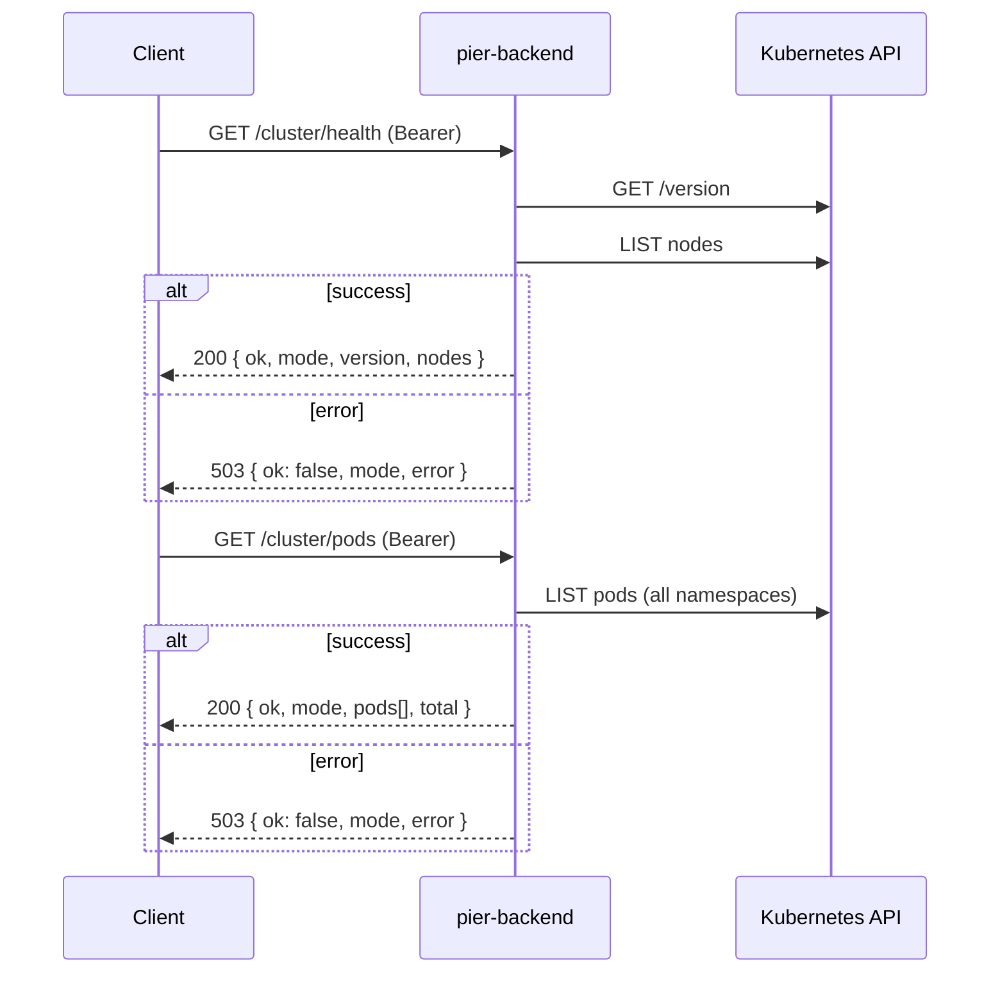

# HTTP routes

Fastify plugins registered from [`../app.ts`](../app.ts). Kubernetes calls live in [`../k8s/`](../k8s/README.md). `cluster.ts` and `apps.ts` export `*RoutesWithDeps()` factories so tests can inject fakes.

| File | Routes |
|------|--------|
| `health.ts` | `GET /health` |
| `cluster.ts` | `GET /cluster/health`, `GET /cluster/pods` |
| `apps.ts` | `GET /apps` |

## Common behaviour

- **Auth** (`../plugins/auth.ts`): every route except `/health` needs `Authorization: Bearer $PIER_API_TOKEN` when a token is configured. A wrong, missing or non-Bearer header returns `401 { "ok": false, "error": "unauthorized" }`. With no token, auth is skipped, which `config.ts` only allows on a loopback `HOST`.
- **Cluster clients**: `buildApp()` in `../app.ts` calls `createK8sClients()` once and passes the result to each route factory. If the kubeconfig failed to load, routes return `503 { "ok": false, "error": "cluster unreachable" }`. The same `503` is returned when a Kubernetes call fails. The full error goes to the server log only, never to the client.
- **Credentials**: `loadKubeConfig()` is called once at startup. Inside a pod it uses the ServiceAccount token (`in-cluster`); outside, `KUBECONFIG` (if set) or `~/.kube/config` (`kubeconfig`). Routes receive the mode from shared clients, so the response's `mode` field is always consistent for the lifetime of the app. A change to `KUBECONFIG` requires a restart.

## Adding a route

New cluster routes (#4 deploy, #5 pods and logs, #6 scale, restart and delete) should follow `apps.ts`:

1. Put the Kubernetes calls in a function in `../k8s/` that takes the API client it needs and throws on error.
2. Export a `*RoutesWithDeps(deps)` factory that takes `k8s: K8sClientsResult`, plus any config it needs, such as `namespace`.
3. Return `503` with the generic body when `deps.k8s.ok` is false or the call throws, and log the error with `req.log.error`.
4. Register it in `buildApp()` with the shared `k8sResult`. Don't call `loadKubeConfig()` or `createK8sClients()` in a route.
5. Test through `buildApp(testConfig(), { logger: false, k8s: createFakeClientsResult({ ... }) })` so auth and registration are covered too.

```ts
// restartApp would live in ../k8s/apps.ts
export function restartRoutesWithDeps(deps: { k8s: K8sClientsResult; namespace: string }): FastifyPluginAsync {
  return async (app) => {
    app.post<{ Params: { name: string } }>("/apps/:name/restart", async (req, reply) => {
      if (!deps.k8s.ok) {
        return reply.status(503).send({ ok: false, error: "cluster unreachable" });
      }
      try {
        return await restartApp(deps.k8s.clients.apps, deps.namespace, req.params.name);
      } catch (err) {
        req.log.error({ err }, "restart app failed");
        return reply.status(503).send({ ok: false, error: "cluster unreachable" });
      }
    });
  };
}
```

## `GET /health`

No auth, no cluster call. Used by the liveness and readiness probes.

```json
{ "ok": true, "service": "pier-backend" }
```

## `GET /cluster/health` and `GET /cluster/pods`



`/cluster/health` returns `200` whenever the API answers. `ok` is `false` if there are no nodes or any node isn't `Ready`.

```json
{ "ok": true, "mode": "in-cluster", "version": "v1.36.5+k3s1", "nodes": { "total": 1, "ready": 1 } }
```

Each entry in `/cluster/pods`'s `pods[]` looks like this (`nodeName` and `startedAt` are omitted when unset):

```json
{ "name": "coredns-7cfb7bc9c7-abcde", "namespace": "kube-system", "phase": "Running", "nodeName": "k3s-node", "ready": "1/1", "startedAt": "2026-10-29T15:00:00.000Z" }
```

RBAC: the ClusterRole `pier-backend-cluster-health` in [`../../k8s/rbac.yaml`](../../k8s/rbac.yaml).

## `GET /apps`

Lists Deployments in `PIER_NAMESPACE` (default `pier-apps`) that have the `pier.app` label. Unlabelled Deployments are skipped. The result is a bare JSON array sorted by name, and `[]` when there are none. Fastify validates it against the response schema in `apps.ts`.

```json
[
  { "name": "hello", "image": "nginx:1.27", "replicas": 2, "ready": 2, "status": "running", "createdAt": "2026-10-29T15:00:00.000Z" }
]
```

- `name` comes from the `pier.app` label value, falling back to `metadata.name`.
- `image` is the first container's image.
- `replicas` is `spec.replicas` (default 1), and `ready` is `status.readyReplicas` (default 0).

`status` (`deriveStatus` in `../k8s/apps.ts`) is decided by the first rule that matches, in this order:

| `status` | Rule |
|----------|------|
| `failed` | `Progressing` reason is `ProgressDeadlineExceeded`, or `Available=False` while `Progressing` isn't `True` |
| `stopped` | `replicas` is 0 |
| `running` | `readyReplicas` and `updatedReplicas` both equal `replicas`, and `observedGeneration` ≥ `generation` |
| `building` | anything else (rollout in progress, pods not ready) |

The 503 body is `{ "ok": false, "error": "cluster unreachable" }`, without `mode`.

RBAC: the Role `pier-app-manager` in [`../../k8s/rbac-apps.yaml`](../../k8s/rbac-apps.yaml), not the cluster ClusterRole.

If an app stays `building` or turns `failed` because Pod Security or the quota rejected its pods, see [Debugging rejected apps](../../k8s/README.md#debugging-rejected-apps).
